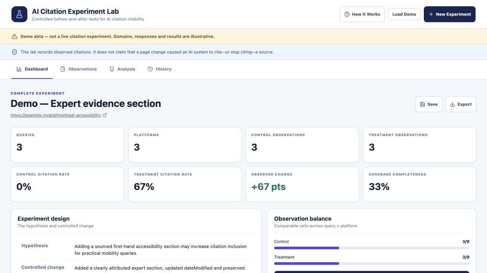

# AI Citation Experiment Lab

Keep content changes, comparison conditions and observed AI citations in one experiment record.

Built by [Ami Saeednia](https://www.seogirl.ca), SEO / GEO Strategist.

[Live app](https://seogirl-ai-citation-experiment-lab.vercel.app/) · [Research and studies](https://www.seogirl.ca/research) · [All tools](https://www.seogirl.ca/apps)

## The problem

Keep content changes, comparison conditions and observed AI citations in one experiment record.

## Who it is for

SEO practitioners documenting controlled content experiments and repeated manual observations.

## Workflow and methodology

Define a hypothesis and control/treatment, record platform, date, response and citation observations, then compare descriptive rates and export the record. The browser stores experiment records in localStorage.

## Evidence and limitations

The included experiment uses demonstration data and example.invalid URLs. This is a manual observation workspace: it does not automatically query ChatGPT or Perplexity. A difference in citation rates does not establish causation, statistical significance or a general ranking effect. Keep prompts, model versions and collection conditions consistent.

The screenshot documents the interface, not an independently validated result. This repository is a practical research tool; its outputs require human review.

## Local setup

Browser-based React / TypeScript / Vite app. Run `npm install`, `npm run dev`, `npm run lint`, and `npm run build`; `npm run preview` serves the built frontend. The manual experiment workflow does not require a Gemini API key. Export work before clearing browser storage; localStorage is not a shared research database.

Review `package.json` for the exact scripts and dependencies. Do not put secrets in frontend code or commit local environment files.

## Background

I build tools to make entity strategy, technical SEO and AI-search research easier to inspect and apply. Explore my [independent studies](https://www.seogirl.ca/research), [workbooks](https://www.seogirl.ca/workbooks) and [project case studies](https://www.seogirl.ca/case-studies).
